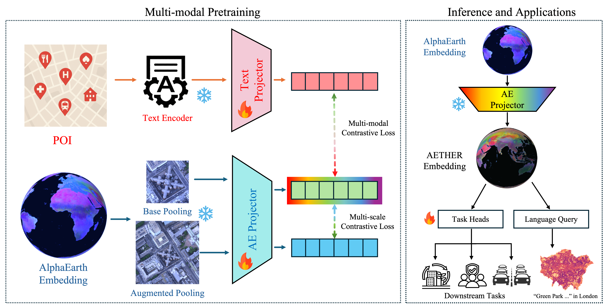

# AETHER: AlphaEarth–POI Enriched Representation Learning


AETHER is a lightweight multimodal alignment framework that aligns **AlphaEarth (AE) embeddings** with **POI-derived urban semantics** through contrastive learning.
The aligned representations support both **urban downstream tasks** and **natural language–conditioned spatial retrieval**.

<p align="center">
  
</p>

Paper:
- https://arxiv.org/abs/2510.09894
- https://www.researchgate.net/publication/396458142

AlphaEarth embeddings are introduced by DeepMind in  
https://deepmind.google/blog/alphaearth-foundations-helps-map-our-planet-in-unprecedented-detail/

## Repository structure

```
aether/            model (AE projector, text head) and data utilities
train.py           pretraining
infer.py           AETHER embedding raster from an AlphaEarth raster
downstream/        LUC, SDM, LUD and GDP evaluation (random or geographically blocked splits)
retrieval/         quantitative compositional retrieval and similarity maps
tools/             POI-density raster for the density controls
configs/           pretraining and downstream configurations used in the paper
data/              downstream labels and retrieval targets
```

## Installation

```bash
conda create -n aether python=3.11
conda activate aether
pip install -r requirements.txt
```

Run all commands from the repository root.

## Data

**Included in `data/`**

| File | Content | Source and licence |
|---|---|---|
| `downstream/ld_sdm_lsoa.geojson` | NS-SeC class shares for 4,994 London LSOAs | ONS Census 2021, Open Government Licence |
| `downstream/sg_lud_h3.geojson` | Land-use composition of 7,282 H3 resolution-9 cells | URA Master Plan 2019, Singapore Open Data Licence |
| `downstream/sg_gdp_2020_3414.tif` | 2020 total GDP (PPP), band 7 of the v3 grid, EPSG:3414 | Kummu et al. (2025), CC BY 4.0 |
| `retrieval/queries.json`, `retrieval/query_embeddings_*.npy` | The 12 retrieval queries (full, CQ, SQ) and their cached `text-embedding-3-large` vectors | this work |
| `retrieval/london_overture_targets.csv` | Category-matching Overture POIs per query on the London AE grid, with the target flag | Overture Maps 2024-12-18.0, CDLA-Permissive-2.0 |

**Trained AETHER embeddings**

The AETHER embedding rasters used in the paper (128 bands, 10 m, 2024) are available on [Google Drive](https://drive.google.com/drive/folders/1_aMlFubQ9DXoe7vT7_NN1aYHS1mxjp_b?usp=sharing):

| File | Size |
|---|---|
| `London_Embedding_AETHER_t3l.tif` | 23 GB |
| `Singapore_Embedding_AETHER_t3l.tif` | 12.8 GB |
| `sg_poi.gpkg` | 77 MB |

Place the rasters at `data/embeddings/London_AETHER.tif` and `data/embeddings/Singapore_AETHER.tif` to run the downstream tasks without pretraining. `sg_poi.gpkg` contains the 411,819 Singapore POIs used for alignment (Foursquare OS Places, Apache 2.0) with their text descriptions. Place it at `data/poi/sg_poi.gpkg`.

**Trained checkpoints**

`checkpoints/aether_london.pth` and `checkpoints/aether_singapore.pth` are the final-epoch models used in the paper. They contain the AE projector and the text head.

**Obtained separately**

- *AlphaEarth embeddings.* Export the 2024 annual layer of `GOOGLE/SATELLITE_EMBEDDING/V1/ANNUAL` from Google Earth Engine for each city as a 64-band GeoTIFF and place it at `data/AE/{London,Singapore}_Embedding_2024AEF.tif`.
- *Licensed data.* The London OS/PointX POIs and the London LUC points (derived from NLUD) cannot be redistributed. They are available from the authors on request for users with the corresponding licences.

POI files must contain point geometries and a `description` field built with the template
`A place of [subcategory], a type of [category], named [name].`

## 1. Pretraining

```bash
python train.py --cfg configs/pretrain_london.yaml
python train.py --cfg configs/pretrain_singapore.yaml
```

POI texts are encoded with OpenAI `text-embedding-3-large` (384 dimensions), so `OPENAI_API_KEY` must be set. Text embeddings and AE window features are cached under `cache/`. Checkpoints are written to `outputs/<run>_<config hash>/ckpts/` (`last.pth` after every epoch), and the paper uses the final epoch.

Any setting can be overridden on the command line, which covers the ablations and sensitivity analyses:

```bash
python train.py --cfg configs/pretrain_london.yaml model.lambda=0.0            # w/o AE-AE consistency
python train.py --cfg configs/pretrain_london.yaml model.ae_type=AEProjLinear  # also AEProj4Layer, AEProjTransformer3
python train.py --cfg configs/pretrain_london.yaml model.out_dim=64            # AETHER-d64
python train.py --cfg configs/pretrain_london.yaml text.backend=hf             # SentenceTransformer all-MiniLM-L6-v2
```

## 2. Inference

```bash
python infer.py --ae_tif data/AE/London_Embedding_2024AEF.tif \
    --ckpt checkpoints/aether_london.pth --out data/embeddings/London_AETHER.tif
```

`--mode window9` averages each band over the masked 9×9 base window before projection (inference-pooling control). Missing AE values are set to zero and each pixel is L2-normalized before projection, so pixels without data receive a constant embedding rather than nodata. The projector type is read from the checkpoint, so models trained with `model.ae_type=AEProjLinear`, `AEProj4Layer` or `AEProjTransformer3` are run the same way.

## 3. Downstream tasks

```bash
python -m downstream.run --cfg configs/downstream/ld_luc.yaml
python -m downstream.run --cfg configs/downstream/ld_sdm.yaml
python -m downstream.run --cfg configs/downstream/sg_lud.yaml
python -m downstream.run --cfg configs/downstream/sg_gdp.yaml
```

Each run trains a two-layer MLP (128 hidden units) on a 72/8/20 split for the five seeds {42, 24, 7, 0, 100} and writes per-seed and averaged metrics to `outputs/downstream/`. GDP targets are z-scored with training statistics, and R², MAE and RMSE are reported on the original scale (MAE and RMSE in billions of 2017 international dollars). `configs/downstream/sg_gdp_log.yaml` trains on log(1 + GDP) instead and reports the metrics in the standardized log space.

| Option | Use |
|---|---|
| `--split block` | 10×10 geographically blocked split |
| `--emb <tif>` | evaluate another embedding raster, e.g. the AlphaEarth raster |
| `--add-density <tif>` | concatenate a POI-density raster (density control) |
| `--seeds 42 24` | run a subset of seeds |
| `key=value` | override any config entry, e.g. `features.buffer_m=100`. Runs with overrides or non-default seeds are saved to separate folders |

Passing the density raster itself to `--emb` gives the density-only control. The density raster is built with

```bash
python tools/make_density_raster.py --poi <poi file> \
    --ref data/AE/Singapore_Embedding_2024AEF.tif --out data/density/Singapore_POI_density.tif
```

## 4. Retrieval

Quantitative compositional retrieval in London, with the full queries and the CQ (spatial clause removed) and SQ (spatial clause replaced) controls:

```bash
python -m retrieval.evaluate --ae_tif data/AE/London_Embedding_2024AEF.tif \
    --ckpt checkpoints/aether_london.pth --out outputs/retrieval
```

The script ranks all 42,394,000 London pixels for each query, breaks ties by pixel index, and reports Recall@K and category-conditional spatial precision for K ∈ {100, 1000, 10000} with an 11×11-pixel hit window. Query vectors are read from `data/retrieval`, so no API call is needed.

Similarity map for any query (needs `OPENAI_API_KEY`):

```bash
python -m retrieval.similarity_map --ae_tif data/AE/London_Embedding_2024AEF.tif \
    --ckpt checkpoints/aether_london.pth \
    --query "Green Park and Natural Reserve" --out outputs/maps/london_green_park.tif
```

## Citation

If you use AETHER in your research, please cite:

    @article{liu2025beyond,
    title   = {Beyond AlphaEarth: Toward Human-Centered Geospatial Foundation Models via POI-Guided Contrastive Learning},
    author  = {Liu, Junyuan and Qin, Quan and Dong, Guangsheng and Wang, Xinglei and Feng, Jiazhuang and Zeng, Zichao and Cheng, Tao},
    journal = {arXiv preprint arXiv:2510.09894},
    year    = {2025},
    url     = {https://arxiv.org/abs/2510.09894}
    }

## License

The code is released under the MIT License. The included data and checkpoints keep the licences of their sources listed above.
